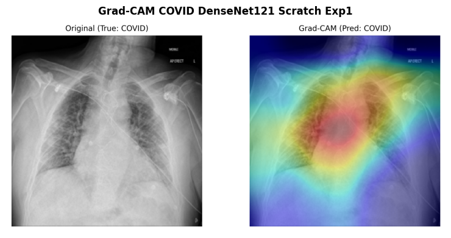
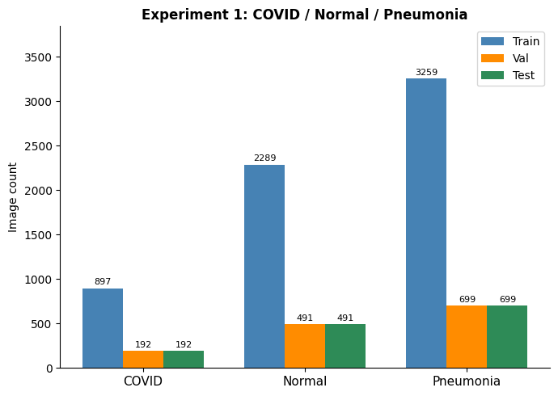
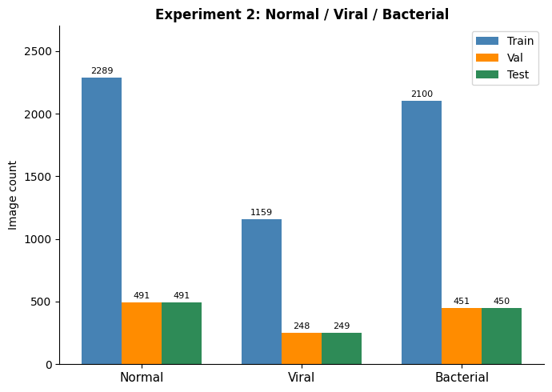
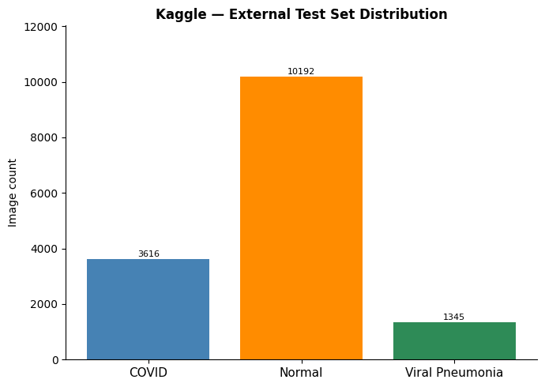

# Comparative Study on Deep Learning for COVID-19 and Pneumonia Detection in Chest X-Rays

**BSc Thesis in Computer Science (Curriculum: Data Analysis)**  
*Università degli Studi di Messina — Academic Year 2025–2026*  
**Author:** Aklesia Berihu Mekonnen | **Supervisor:** Prof. Ing. Armando Ruggeri

---

## Overview

Accurate differentiation of COVID-19, viral pneumonia, and bacterial pneumonia from chest X-rays remains a critical clinical challenge. This study conducts a strictly controlled comparison of **nine deep learning configurations**—spanning **CNN**, **ResNet50**, **ResNet101**, **ResNet152**, and **DenseNet121** (trained from scratch and via transfer learning)—across two three-class classification tasks:

1. **Experiment 1 (3-Class Detection):** `COVID-19` vs. `Normal` vs. `Pneumonia`
2. **Experiment 2 (3-Class Pneumonia Classification):** `Normal` vs. `Viral Pneumonia` vs. `Bacterial Pneumonia`

To eliminate confounding factors, all models shared an identical classification head, data augmentation pipeline, optimizer, and training budget. **Weight initialization** and **learning rate schedule** were the sole experimental variables.

---

## Datasets

- **Internal Training & Evaluation:** Mendeley Extensive COVID-19 X-Ray Dataset
- **External Cross-Dataset Validation:** Kaggle COVID-19 Radiography Dataset (**15,153 images**), used to evaluate all nine Experiment 1 models without retraining to measure cross-dataset generalization.

*(Raw image datasets are not hosted in this repository; please download them directly from Mendeley and Kaggle.)*

---

## Key Findings

| Evaluation Setting | Top Performing Model(s) | Macro AUC | Key Takeaway |
| :--- | :--- | :---: | :--- |
| **Internal Validation** | DenseNet121 (Scratch) & ResNet152 (Scratch) | **0.9980** | Transfer learning offered no reliable advantage over scratch training in either experiment. |
| **External Validation (15,153 images)** | DenseNet121 (Transfer Learning) | **0.8299** | Achieved the smallest generalization gap despite ranking fifth internally—demonstrating that internal AUC does not reliably predict deployment performance. |

- **Statistical Analysis:** Formal statistical testing confirmed that only one model pair showed a statistically significant performance difference after **Bonferroni correction**.
- **Explainability (XAI):** Post-classification visualization via **Grad-CAM** and **Canny ROI detection** confirmed clinically plausible model attention patterns across both experiments.

---

## Visual Results

### Grad-CAM Explainability (COVID-19)

### Dataset Class Distributions
| Experiment 1 (Internal) | Experiment 2 (Internal) | External Validation (Kaggle) |
| :---: | :---: | :---: |
|  |  |  |

---

## Key Files

*(Because all nine model configurations shared an identical training pipeline, representative top-performing scripts are included here for clarity.)*

- `01_dataset_setup_eda_split.py` — Dataset setup, EDA, and train/val/test splitting
- `09_exp1_densenet121_scratch.py` — Experiment 1 top internal model (DenseNet121 Scratch)
- `26_exp2_04_densenet121_transfer_fair_he...` — Experiment 2 training pipeline *(replace with full filename)*
- `20_kaggle_external_test_.py` — External cross-dataset validation on 15,153 Kaggle images (without retraining)
- `final_analysis.py` — Final comparative metrics, statistical testing, and analysis
- `requirements.txt` — Python dependencies
- [`8_Mekonnen_abstract.pdf`](./8_Mekonnen_abstract.pdf) — 1-page thesis executive summary
